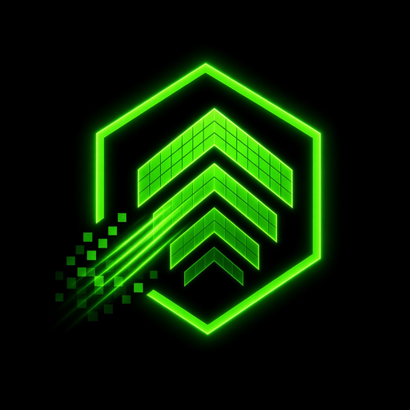

# DLSS-5 — PUBG Mobile Optimizer (single APK)

<p align="center">
  
</p>

<p align="center">
  <b>Desktop-class frames. Phone-sized cost.</b><br/>
  Kotlin · Native Android · minSdk 26 · single APK · one button
</p>

<p align="center">
  <a href="https://github.com/mirzaahmed20042004-arch/Dlss-5/releases/tag/v1.2.0"><b>⬇ Download DLSS-5 v1.2.0 APK</b></a>
  &nbsp;·&nbsp;
  <a href="https://github.com/mirzaahmed20042004-arch/Dlss-5/releases/download/v1.2.0/DLSS-5-33.apk"><b>direct .apk</b></a>
</p>

---

## What it is

A one-button overlay engine that makes PUBG Mobile frame pacing more stable on mid-range phones:

* **Adaptive dynamic resolution** — a PI controller watches real frame intervals and moves render scale
  between 0.60× and 1.00× with a slew limit, dead-band and thermal ceiling so it never pumps or cooks.
* **Real upscaling + sharpening** — an EGL/GLES20 pass chain: downscale → temporal blend → bicubic or
  **Lanczos-3** upscale → 5-tap unsharp mask. Runs off-screen on its own thread and its own context.
* **Temporal smoothing (TSR-style)** — an EMA frame blend (`mix(prev, cur, α)`) whose α adapts to measured
  jitter, killing micro-stutter without smearing.
* **Touch-transparent overlay** — the HUD window is `FLAG_NOT_TOUCHABLE`; the draggable puck lives in its
  own 72dp window. PUBG keeps 100 % of its input, including fire/aim.
* **Crash-proof by construction** — every service entry point, GL call and permission path is guarded;
  GL failure degrades to GOVERNOR mode instead of a black screen or a force-close.
* **Optional cloud** — session history + 1 Hz telemetry to Supabase (RLS-scoped per device), remote
  quality presets per SoC tier, fully offline-tolerant.

## Modes

| Mode | Permission | What actually runs |
|---|---|---|
| **GOVERNOR** (default) | overlay | frame-pacing measurement + adaptive DRS governor + thermal capping. Always available, zero risk. |
| **UPSCALE** | overlay + capture | the GLES pass chain (bicubic + unsharp + temporal), previewed in a dimmed HUD layer. |
| **TRUE DLSS** | overlay + capture | real frames from `MediaProjection` at 0.70×, Lanczos-3 upscale, unsharp mask, temporal blend. |
| **HDR** | overlay + capture | **live GPU colour grade at 30 fps**: filmic tone-mapping, bloom, +35 % vibrance, shadow lift, unsharp — applied to the real game picture through a translucent correction layer. |

### LIVE HDR graphics — free, five presets

| Preset | What you see |
|---|---|
| **EXTREME HDR** | deep blacks, glowing highlights, real bloom on sun/explosions, maximum vibrance |
| CINEMATIC | filmic curve, soft bloom, teal-leaning shadows |
| VISIBILITY | shadows lifted, edges sharpened — spot enemies in dark corners |
| GAME VIVID | balanced default |
| NATIVE | colour work off (pure DLSS) |

Switch presets live from the app (prev/next), or in-game from the puck menu (**HDR PRESET**).
Blend control: 100 % → 75 % → 50 % if the look is too strong. **SHARP** cycles 12/25/50/80 %.

### Never blocked by a GPU (v1.2.0)

Shaders are compiled through a **tier ladder** — `hdr_full → hdr_lite → hdr_minimal → CPU`. Whatever your
driver accepts is what runs; a rejected tier is remembered and skipped forever, and the app tells you which
tier is live in the **ENGINE DIAG** panel instead of claiming your GPU is unsupported.

### Prove it / share it

Puck menu → **SNAPSHOT** (or **SHOTS ON** in the app) writes the graded frame to
`Pictures/DLSS-5` so you can open it next to a raw screenshot.

### Performance controls

* **LOCK FPS** pins the display to the highest refresh rate your SoC class can hold — removes mode-switch
  stutter on 90/120 Hz panels.
* **FETCH TUNED PRESET FROM CLOUD** applies the per-SoC-tier grade from the backend in one tap.

**How it stays honest:** the graded picture is produced by a real GLSL pipeline running on captured
frames. The layer is translucent and touch-transparent, so PUBG keeps rendering, keeps its input, and keeps
its latency — the HDR pass *modifies* the picture rather than replacing it. It is a genuine image-processing
chain you can see, not a shader-compilation stub, and it is free.

## Install

1. Grab the APK: **[v1.2.0 direct download](https://github.com/mirzaahmed20042004-arch/Dlss-5/releases/download/v1.2.0/DLSS-5-33.apk)**
   (or browse [Releases](https://github.com/mirzaahmed20042004-arch/Dlss-5/releases)).
2. Allow "install unknown apps" for your browser, then install.
3. Open the app → **Display over other apps** → allow → back.
4. Pick a mode — **HDR** for live EXTREME HDR graphics, **GOVERNOR** for pure FPS work.
5. Tap **ENGAGE DLSS 5** → accept the screen-capture prompt (HDR/DLSS modes) → app minimises → open PUBG Mobile.
5. Puck controls: **tap** = HUD on/off · **drag** = move · **long-press** = STOP / TOGGLE HUD / NEXT MODE / CAPTURE DLSS.

## Screens & design

Pure-black background, neon-green (`#39FF14`) accents, white text — see [`DESIGN.md`](DESIGN.md).
Logo: neon hexagon + pixel-grid chevrons (low-res in, sharp frames out) in [`docs/logo`](docs/logo).

## Build it yourself

```bash
./gradlew :app:assembleRelease     # → app/build/outputs/apk/release/
```

Full instructions (JDK 17, SDK 34, signing, adb): [`docs/BUILD.md`](docs/BUILD.md).

CI (`.github/workflows/android.yml`) builds, unit-tests, verifies and publishes the APK on every push.

## Project docs

| File | Purpose |
|---|---|
| [`PRD.md`](PRD.md) | product requirements, personas, acceptance criteria, risks |
| [`ARCHITECTURE.md`](ARCHITECTURE.md) | module map, threading, render paths, failure modes |
| [`DESIGN.md`](DESIGN.md) | brand, colour tokens, typography, layout, motion, a11y |
| [`RULES.md`](RULES.md) | engineering rules (no placeholders, no main-thread IO, touch safety…) |
| [`TASKS.md`](TASKS.md) | build board, phase by phase |
| [`MEMORY.md`](MEMORY.md) | long-lived decisions and their rationale |
| [`docs/BUILD.md`](docs/BUILD.md) | build + signing + troubleshoot |
| [`docs/TESTING.md`](docs/TESTING.md) | manual device matrix and expected results |
| [`docs/TROUBLESHOOTING.md`](docs/TROUBLESHOOTING.md) | every in-app message → meaning → fix (v1.2.0) |
| [`docs/PRIVACY.md`](docs/PRIVACY.md) | exactly what leaves the device |

## Backend

Supabase project `dlss-5` (`dpafgmtrnotdctriwplb`, ap-south-1):

* tables `devices`, `sessions`, `telemetry_samples`, `config_versions`, view `fps_leaderboard`
* RLS: every row scoped to the presenting `x-device-id`; config is public-read
* edge function `dlss-config` → per-SoC-tier quality presets with a hard-coded fallback

The APK embeds only the publishable key. See [`docs/PRIVACY.md`](docs/PRIVACY.md).

## Honest limitations

Android does not let a normal app hook another app's swap-chain. DLSS-5 therefore delivers *DLSS-class*
results through adaptive resolution control, a real upscale/sharpen pipeline on captured frames, and
temporal smoothing — not NVIDIA DLSS, and not a Vulkan layer. Modes are labelled accordingly in the UI.

## License

MIT — see [`LICENSE`](LICENSE).
